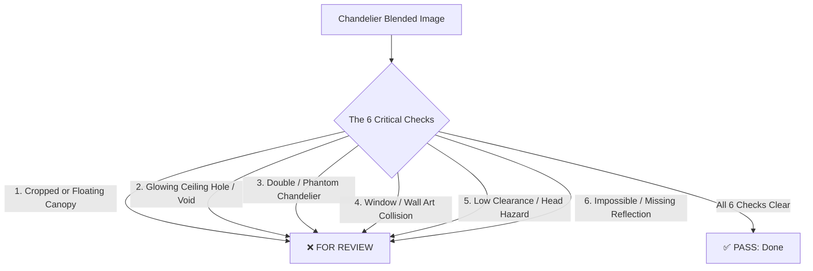

# Chandelier Blended Image Visual QA Skill

This skill defines the definitive quality standards, defect taxonomy, and forensic inspection criteria for auditing AI-blended chandeliers across all HomeCartel social feed pipelines.

**Ground Truth**: Derived directly from the forensic visual audit of **15 production Airtable records** marked **`Discard`** and **`For Manual`** (including *Umea Lin*, *Vizima*, *Fia*, *Limon*, *Krame*, *Hera Trois*, *Gamli 120*, *Deimos*).

---

## 1. When to Use

- When Claude Sonnet 5 Vision inspects a blended chandelier image immediately after Nano Banana Pro generation.
- When generating blending prompts for chandeliers to actively prevent mounting and oversizing errors.
- When reviewing or troubleshooting why an Airtable chandelier row was flagged as `For Review`, `For Manual`, or `Discard`.

---

## 2. The 6 Critical Chandelier Failures (Airtable Forensic Evidence)

Our audit of rejected production chandelier images revealed 6 distinct recurring defects:



### 1. Cropped or Floating Canopy (`CROPPED_OR_FLOATING_CANOPY`)
*Observed in: `Umea Lin` (rec0pH8z06y2V2ncf), `Vizima` (recJxlbF2OpgreQfX), `Krame` (recrA7IGiifJktVMT), `Gamli 120` (recGIw51vvr3YuZYC)*
- **Defect**: Suspension rods or cables originate directly from the top cropped edge of the image, or the canopy hovers 5–20 cm below the ceiling slab without touching it.
- **Rule**: A chandelier must have a visibly seated, flush mounting canopy/escutcheon attached directly to the ceiling drywall/slab with visible contact shadow.

### 2. Ceiling Dissolving into Glowing Void / Cutout (`CEILING_HOLE_ARTIFACT`)
*Observed in: `Limon` (recOVjiL5W4TLnrp2)*
- **Defect**: The canopy area dissolves into a glowing, oddly-shaped oval white void or digital cutout that looks like a skylight glitch rather than physical mounting hardware.
- **Rule**: The junction box connection must be architectural metal/canopy hardware, never an abstract glowing cloud or digital seam.

### 3. Double / Phantom Fixture Overlap (`PHANTOM_FIXTURE_OVERLAP`)
*Observed in: `Fia` (recWfAOJ1cIjnUKou)*
- **Defect**: The AI generates a second, unrelated fixture (e.g., an extra brass sputnik chandelier) overlapping or intersecting the hero chandelier, creating a confusing double-canopy mess.
- **Rule**: Exactly ONE chandelier must exist in the frame. Zero ghost fixtures, zero secondary hanging canopies.

### 4. Window Frame, Mantel, or Wall Art Collision (`ARCHITECTURAL_COLLISION`)
*Observed in: `Umea Lin`, `Krame`, `Gamli 120`*
- **Defect**: Chandelier is hung directly overlapping architectural window mullions, crowding within centimeters of a fireplace mantel, or crossing directly in front of framed artwork.
- **Rule**: The chandelier must sit as a deliberate focal point with at least 1 meter of visual breathing room from window mullions, mantels, and side walls.

### 5. Low Clearance / Head-Strike Hazard (`LOW_CLEARANCE_HAZARD`)
*Observed in: `Hera Trois` (recb6okDbhZCavevt), `Umea Lin`, `Gamli 120`*
- **Defect**: The fixture's lowest ring or shade hangs dangerously low over sofa backs or open walking pathways (less than 2.1m / 7ft from floor level).
- **Rule**: In living rooms, chandeliers must clear at least 2.1m (7ft) above floor level. In dining rooms, the lowest point must maintain 75–90 cm (30–36 in) clearance above the tabletop.

### 6. Impossible Mirror Reflections or Missing Shadows (`REFLECTION_SHADOW_DISCONNECT`)
*Observed in: `Limon`, `Deimos`, `Vizima`*
- **Defect**: A mirror below depicts an impossible phantom angle of the chandelier, or a glossy dining table directly underneath an illuminated chandelier has zero reflection of the warm light.
- **Rule**: If glossy tables, mirrors, or marble floors are directly beneath, realistic light reflection and soft ceiling shadow bounce must be present.

---

## 3. Systematic Inspection Protocol for AI Reviewer

When Claude Sonnet 5 Vision audits a blended chandelier photo, it must execute this 4-step checklist:

| Step | Checkpoint | Pass Criteria | Reject / Flag Criteria |
|:---:|:---|:---|:---|
| **1** | **Canopy Mount** | Solid, flush canopy seated against ceiling with contact shadow. | Rods cut off by image edge, floating in air, or glowing oval holes. |
| **2** | **Suspension Wires** | Straight, continuous cables connecting fixture to canopy. | Severed wires, dashed lines, cables dissolving mid-air, uneven tilts. |
| **3** | **Scale & Living Room Volume** | Chandelier occupies $\le 30\%$ of visual frame, generous headroom. | Fixture massive, overlaps window frame or art, head hazard. |
| **4** | **Fixture Isolation** | Exactly ONE crisp chandelier matching the product design. | Secondary ghost chandeliers, melted metal loops, warped glass. |

---

## 4. Prompt Template for Fal AI / Claude Sonnet 5 Vision API

```text
You are the Luxury Lighting Quality Director for HomeCartel.
Audit this AI-blended photo of a chandelier in a luxury room.

CHECK FOR THE 6 DECISIVE CHANDELIER DEFECTS (Airtable Ground Truth):
1. CROPPED_OR_FLOATING_CANOPY: Are rods originating from the image top edge? Is the canopy hovering below the ceiling without flush contact?
2. CEILING_HOLE_ARTIFACT: Is the mounting point a glowing white oval void or digital seam instead of real hardware?
3. PHANTOM_FIXTURE_OVERLAP: Did the AI hallucinate a second chandelier or extra arms/canopies intersecting the main product?
4. ARCHITECTURAL_COLLISION: Does the chandelier overlap window mullions, crowd the fireplace mantel, or block framed wall art?
5. LOW_CLEARANCE_HAZARD: Does the chandelier hang dangerously low over sofa backs or walking paths (< 2.1m / 7ft)?
6. REFLECTION_SHADOW_DISCONNECT: Are mirror reflections impossible or tabletop reflections completely missing?

DECISION CRITERIA:
- If mounting is flush and structural, scale is elegant and proportional, clearance is generous, and product is isolated -> "verdict": "PASS".
- If ANY of the 6 defects are detected -> "verdict": "FOR_REVIEW".

Return valid JSON ONLY matching this schema:
{
  "verdict": "PASS" | "FOR_REVIEW",
  "defects_detected": ["CROPPED_OR_FLOATING_CANOPY", "LOW_CLEARANCE_HAZARD", ...],
  "mounting_check": "Detailed assessment of canopy-to-ceiling junction.",
  "scale_and_clearance_check": "Assessment of fixture volume relative to living room / dining room.",
  "critique_summary": "Itemized explanation of why the image passes or why it must be reviewed by a human."
}
```

---

## 5. Pipeline Actions on Verdict

When the Python QA engine (`content_automation/feed_qa.py`) evaluates the verdict:

```python
if qa_result["verdict"] == "FOR_REVIEW":
    # 1. Update row Status to "For Review" in Airtable
    airtable.update_record(record_id, {"Status": "For Review"})
    
    # 2. Populate 'Blend Review Notes' with Claude's itemized audit
    airtable.update_record(record_id, {"Blend Review Notes": qa_result["critique_summary"]})
    
    # 3. Halt downstream processing (skip caption, do not set Done)
    print(f"  [FOR REVIEW] Chandelier flagged: {qa_result['defects_detected']}")
    return False
else:
    # 4. Passed QA - Set Done and continue to auto-post
    airtable.update_record(record_id, {"Status": "Done"})
    print("  [PASS] Chandelier passed mounting and scale QA!")
    return True
```
