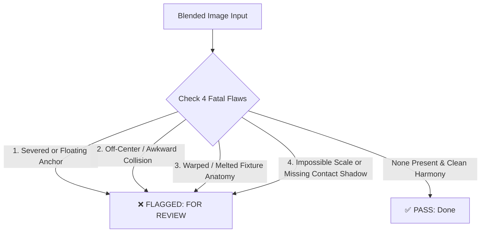

# Feed Blended Image Visual QA & Review Skill

This skill provides the exact criteria, defect taxonomy, and real-world failure patterns for evaluating whether AI-blended lighting fixtures in luxury interior scenes are ready for publishing or must be routed to **`"For Review"`** / **`"For Manual"`** / **`"Discard"`**.

Ground truth: Built directly from forensic visual audits of Airtable records marked **`Discard`** and **`For Manual`** across HomeCartel Chandelier and Collection tables.

---

## 1. When to Use

- When Claude Sonnet 5 Vision inspects blended images at the end of Feed pipelines (e.g., Phase 6 in `run_collection_category_feed.py`).
- When defining or updating quality rubrics, visual QA prompt templates, or automated sanity checks.
- When troubleshooting why an image was rejected or flagged in Airtable.

---

## 2. Real-World Defect Case Studies (From Airtable Discard/Manual Records)

Below are actual production examples extracted from Airtable showing what causes a blended image to fail:

### Case 1: `Deimos` Chandelier (`collection_category_feed`, Record `recfzGU0YVNlIJRSd`)
*Status: `Discard`*
- **Defect 1 (Critical Misplacement)**: The chandelier was placed completely off-center, hanging over the left edge/corner of the dining table rather than centered over the long axis of the table.
- **Defect 2 (Severed Suspension)**: Several suspension cables terminated abruptly in mid-air or dissolved into the ceiling without physically connecting to the canopy.
- **Defect 3 (Missing Contact Reflections)**: Despite the glossy dark wood dining table, there were zero reflections of the illuminated glass shades on the tabletop.

### Case 2: `Zygadlo` Floor Lamp (`collection_category_feed`, Record `recEZh2JFgFUcQ5Nz`)
*Status: `Discard`*
- **Defect 1 (Hovering Base / Missing Contact Shadow)**: The trumpet base of the lamp floated slightly above the marble floor with no dark contact shadow pressing it down.
- **Defect 2 (Structural Deformation)**: The base-to-stem joint had an unnatural AI pinch/melt, and the decorative brass ring was misaligned and floating off the black lacquer.
- **Defect 3 (Background Inpainting Seam)**: The sheer curtains and dark-framed bathroom glass behind the lamp had melted vertical streaks and warped lines from AI inpainting.

### Case 3: `Umea Lin` Linear Chandelier (`chandeliers_day_night_4_5`, Record `rec0pH8z06y2V2ncf`)
*Status: `For Manual`*
- **Defect 1 (Scale Crowding & Low Clearance)**: The fixture was excessively oversized for the room footprint, crowding within inches of the window mullions and stone wall returns, and hung dangerously low into human walking clearance.
- **Defect 2 (Uneven Shade Spacing & Tilt)**: The 5 cylindrical shades had irregular gaps (gaps between shades 2–3 were tighter than 1–2) and inconsistent tilt angles, breaking geometric rhythm.
- **Defect 3 (Floating Mount)**: The mounting plate appeared stuck onto the ceiling without a proper transition canopy or junction box.

### Case 4: `Vizima` & `Fia` (`chandelier_cta_story`, Records `recJxlbF2OpgreQfX`, `recWfAOJ1cIjnUKou`)
*Status: `Discard` / `For Manual`*
- **Defect**: Warped, asymmetric ring silhouettes where circular LED loops lost curvature and looked hand-drawn or melted.

---

## 3. The 4 Fatal Flaws (Immediate "For Review" / Rejection)

Any AI reviewer inspecting a blended image MUST immediately flag the row if ANY of these 4 flaws exist:



1. **Severed or Floating Anchor (`SEVERED_SUSPENSION` / `FLOATING_FIXTURE`)**:
   - Pendants/chandeliers whose cords stop mid-air before touching the ceiling.
   - Sconces hovering in front of walls without a mounting plate flush to the surface.
   - Table or floor lamps hovering in air with no contact shadow on the floor or nightstand.
2. **Off-Center / Awkward Collision (`AWKWARD_PLACEMENT`)**:
   - Chandelier hanging over a chair or edge of table instead of centered over the dining table.
   - Fixtures physically colliding or intersecting headboards, pillows, or window frames.
3. **Warped / Melted Geometry (`MELTED_GEOMETRY`)**:
   - Bent downrods, asymmetrical rings, wavy glass globes, or melting crystal arms.
4. **Scale & Environmental Mismatch (`SCALE_MISMATCH` / `LIGHTING_DISCONNECT`)**:
   - A fixture scaled 2x too large or 0.5x too small relative to surrounding furniture.
   - A brightly glowing fixture that casts zero light, shadow, or reflection on glossy tables, walls, or ceilings.

---

## 4. Room-by-Room Evaluation Rules for Collection Category Feed

When evaluating a full 5-slide Collection Category Feed:

| Slot | Room Type | Allowed Fixture Types | Key Inspection Rules |
|:---:|:---|:---|:---|
| **Slot 1** | Modern Exterior | *None (Cover)* | Verify clean architectural facade and clear HomeCartel brand logo. |
| **Slot 2** | Modern Bedroom | `pendant_lights` OR `table_lamps` | • **Pendant**: Straight vertical drop beside headboard, anchored to ceiling.<br/>• **Table Lamp**: Firmly grounded on bedside nightstand surface with contact shadow. |
| **Slot 3** | Modern Dining Room | `chandeliers` OR `pendant_lights` (Linear) | • Centered over the long axis of the dining table.<br/>• Vertical clearance: 75–90cm above tabletop.<br/>• Clean ceiling canopy. |
| **Slot 4** | Modern Kitchen | `wall_lights` (Sconces) | • Backplate mounted flush against backsplash or wall.<br/>• Never hovering in mid-air over the island. |
| **Slot 5** | Modern Living Room | `chandeliers` OR `floor_lamps` | • **Chandelier**: Proportional to central ceiling height.<br/>• **Floor Lamp**: Base flat on floor plane beside sofa or reading corner. |

---

## 5. Output Actions & Status Handling

When the AI visual QA finishes evaluating the blended slots:

- **If ALL slots PASS**:
  - `Status` $\rightarrow$ **`Done`**
  - Proceed to write Instagram caption and mark complete for the auto-post scheduler.
- **If ANY slot FAILS (1-Time Self-Healing Retry)**:
  - **Do NOT discard the entire row**: Slots that passed are 100% preserved.
  - Claude provides an actionable `correction_instruction` (e.g. *"Mount canopy flush to ceiling, reduce width by 25%"*).
  - The pipeline re-blends **ONLY the defective slot ONCE**, re-stamps the YOLO tag and Feed logo, and updates the Airtable attachment.
  - **Round 2 QA Re-check**:
    - **If healed**: `Status` $\rightarrow$ **`Done`**, note logged as `(healed on retry)`. All 5 photos intact!
    - **If still defective after 1 retry**: `Status` $\rightarrow$ **`For Review`**, write diagnosis to **`Blend Review Notes`**, and halt auto-publishing for human inspection:
      ```text
      Slot 2 (Bedroom - Pendant): PASS - Realistic ceiling anchor.
      Slot 5 (Living Room - Chandelier): FAIL (failed after 1 retry) [LIVING_ROOM_OVERSIZING] - Chandelier is too large for the living room sofa span.
      ```
