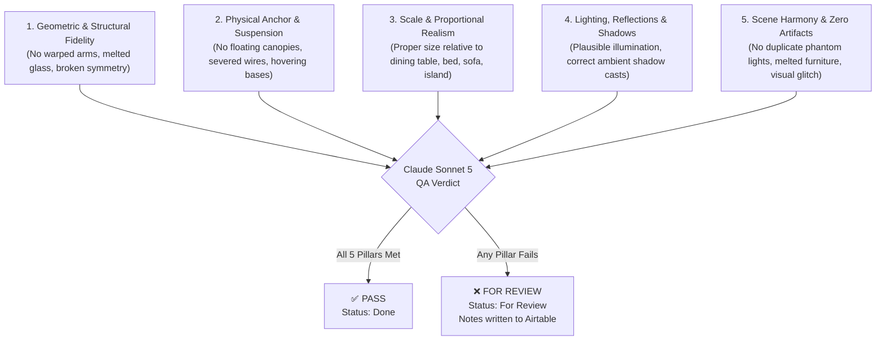

# Collection Category Feed: Blended Image AI QA & Inspection Guide

> **Single Source of Truth for AI Visual Quality Assurance**  
> This document specifies how Claude Sonnet 5 Vision analyzes and evaluates the blended images in the **Collection Category Feed** (`run_collection_category_feed.py`), defining exact criteria for **Pass** vs **"Hindi Okay" (For Review)**, defect taxonomies, prompt instructions, and Airtable status workflows.

---

## 1. Executive Purpose & Quality Objective

In the **Collection Category Feed**, 4 distinct lighting products are blended into 4 room interiors (Bedroom, Dining Room, Kitchen, Living Room) alongside an exterior cover slide.

Because the final carousel is automatically picked up by the **Instagram Auto-Post Scheduler**, **no flawed, distorted, or unrealistic AI generation must ever be published live**. 

The **Claude Sonnet 5 Vision QA Phase (Phase 6)** acts as the automated quality gatekeeper:
- **Pass**: All 4 blended slides meet HomeCartel luxury lighting e-commerce standards $\rightarrow$ Status sets to **`Done`** and generates an Instagram caption.
- **Hindi Okay (Defective)**: Any blended slide exhibits visual flaws or physical implausibility $\rightarrow$ Claude generates an itemized critique, records it to **`Blend Review Notes`**, and sets Status to **`"For Review"`**, halting automatic scheduling so a human can inspect it.

---

## 2. Core Evaluation Pillars (The 5 Pillars of Luxury Lighting)

When Claude Sonnet 5 inspects each blended photo against the original product photo and room interior, it evaluates across five specific pillars:



---

## 3. Room-by-Room Inspection Checklist

Each room has unique architectural anchor points and lighting functions:

### Slot 2: Modern Bedroom (`Interior2` $\rightarrow$ `Blended Image2`)
*Candidate Fixtures: `pendant_lights` OR `table_lamps`*

- **If Pendant Light**:
  - [ ] **Ceiling Anchor**: The suspension cord/cable must connect cleanly to the ceiling (no cutoff mid-air).
  - [ ] **Bedside Drop**: The fixture must hang at a realistic height beside the bed/nightstand (not intersecting the headboard or pillow).
  - [ ] **Cord Straightness**: Cords or downrods must be vertically straight, not wavy or warped.
- **If Table Lamp**:
  - [ ] **Surface Contact**: The lamp base must sit flat and firmly on top of the bedside nightstand (no hovering).
  - [ ] **Scale**: The lamp should occupy 30%–60% of the nightstand height, not overpower the bed.

### Slot 3: Modern Dining Room (`Interior3` $\rightarrow$ `Blended Image3`)
*Candidate Fixtures: `chandeliers` OR `pendant_lights` (Linear Dining Pendant)*

- [ ] **Table Centering**: The fixture must be plausibly centered directly above the dining table.
- [ ] **Clearance Elevation**: Must hang with realistic clearance above the tabletop (approx. 75–90 cm / 30–36 in visually; neither resting on table nor crushed against ceiling).
- [ ] **Symmetry & Geometry**: Chandelier arms, rings, or linear frames must not look melted, bent, or deformed.
- [ ] **Canopy Connection**: Ceiling mount canopy must be flush against the ceiling surface.

### Slot 4: Modern Kitchen (`Interior4` $\rightarrow$ `Blended Image4`)
*Candidate Fixtures: `wall_lights` (Sconces / Accent Wall Lights)*

- [ ] **Wall Mount Flushness**: The backplate/canopy must mount flush against a kitchen wall, backsplash, or architectural column.
- [ ] **No Floating Sconces**: Must not float mid-air over the kitchen island without a wall support.
- [ ] **Hardware Alignment**: Sconce arms or directional shades must be structurally straight.

### Slot 5: Modern Living Room (`Interior5` $\rightarrow$ `Blended Image5`)
*Candidate Fixtures: `chandeliers` OR `floor_lamps`*

- **If Chandelier**:
  - [ ] **Ceiling Volume**: Must fit the room's height. Must not visually collide with ceiling fans, beams, or tall floor furniture.
  - [ ] **Central Anchor**: Cleanly anchored to the living room ceiling.
- **If Floor Lamp**:
  - [ ] **Floor Contact**: Base must rest flat on the floor plane next to a sofa, armchair, or corner.
  - [ ] **Stem Rigidity**: The vertical or arched pole must be straight and physically plausible (no rubbery bends unless part of the original design).
  - [ ] **Proportions**: Height should typically reach between eye-level sitting and standing (approx. 140–180 cm relative to the sofa).

---

## 4. Defect Taxonomy ("Hindi Okay" Triggers)

Any of the following critical defects will automatically trigger **`FOR_REVIEW`**:

| Defect Code | Defect Name | Severity | Description & Visual Indicator |
|---|---|---|---|
| `SEVERED_SUSPENSION` | Severed Cable / Cord | **Fatal** | Pendant or chandelier cord stops in mid-air with no ceiling mount. |
| `FLOATING_FIXTURE` | Floating Base / Mount | **Fatal** | Table lamp floating above table, floor lamp hovering above floor, or sconce hovering off wall. |
| `MELTED_GEOMETRY` | Warped / Melted Fixture | **Fatal** | Metal rings, crystal arms, glass globes, or shades deformed by AI generation. |
| `SCALE_MISMATCH` | Absurd Scale / Dimension | **Fatal** | Miniature chandelier smaller than a plate, or giant table lamp taller than a person. |
| `PHANTOM_FIXTURES` | Duplicate / Ghost Lights | **Fatal** | AI generated extra random bulbs, second deformed fixture, or floating duplicate pieces. |
| `SURFACE_COLLISION` | Awkward Intersection | **High** | Fixture phasing through walls, headboards, table surfaces, or chairs. |
| `UNNATURAL_LIGHT` | Blackout / Glitched Shading | **High** | Black voids around fixture, jagged halos, or inverted lighting artifacts. |

---

## 5. Claude Sonnet 5 Vision QA Prompt Specification

Below is the exact system instruction and prompt template executed by `content_automation/feed_qa.py`:

```text
You are the Chief Quality Assurance Inspector and Luxury Creative Director for Home Cartel.
Your job is to rigorously inspect whether AI-blended lighting products look photorealistic,
physically plausible, and commercially pristine for luxury Instagram feed publishing.

You are provided with:
- The original product photos for Slots 2 to 5.
- The final blended room photos for Slots 2 to 5 (Blended Image2..5).

EVALUATION CRITERIA:
1. Physical Anchor: Cords must connect cleanly to ceiling. Bases must rest flat on surfaces. Sconces must mount to walls. Zero floating fixtures.
2. Geometric Integrity: Fixture shapes must be crisp, symmetrical, and faithful to original product design. No melted metal, wavy glass, or distorted silhouettes.
3. Realistic Scale: Fixtures must match natural human scale relative to beds, dining tables, counters, and sofas.
4. Clean Composition: No weird AI hallucinations, ghost objects, severed cables, or severe digital artifacts.

STRICT VERDICT RULES:
- If ALL 4 slots are clean, photorealistic, and ready for commercial post -> return "overall_verdict": "PASS".
- If ANY of the 4 slots has a defect (floating, melted, severed, absurd scale) -> return "overall_verdict": "FOR_REVIEW".

CRITICAL: Return valid JSON ONLY matching this exact schema:
{
  "overall_verdict": "PASS" | "FOR_REVIEW",
  "summary": "One sentence summary of the inspection result.",
  "slot_reviews": [
    {
      "slot": 2,
      "room": "Modern Bedroom",
      "category": "pendant_lights" | "table_lamps",
      "status": "PASS" | "FOR_REVIEW",
      "defects": ["SEVERED_SUSPENSION", "MELTED_GEOMETRY", ...],
      "critique": "Specific explanation of what is defective or why it passes."
    },
    ...
  ]
}
```

---

## 6. Airtable Schema & Status Lifecycle

### Airtable Fields Used

| Field Name | Field Type | Purpose | Example Value |
|---|---|---|---|
| `Status` | `singleSelect` | Lifecycle state of the row | `Done` (All passed/healed) or `For Review` (Defect persists after 1 retry) |
| `Blend Review Notes` | `multilineText` | Claude's detailed inspection breakdown and retry audit | Itemized report noting `PASS`, `[DEFECT_CODE]`, and `(healed on retry)` |

### Sample Output in `Blend Review Notes` (When Hindi Okay)

```text
[QA REVIEW: 2026-10-30 08:50:00 AM PHT] - VERDICT: FOR REVIEW
Summary: Slot 3 (Dining Room) has a severed suspension cable and Slot 5 (Living Room) has melted chandelier arms.

• [Slot 2: Bedroom] PASS - Pendant light hangs cleanly beside headboard with realistic ceiling anchor.
• [Slot 3: Dining Room] FOR_REVIEW - [SEVERED_SUSPENSION] The chandelier cord terminates in mid-air 20cm below the ceiling with no ceiling canopy.
• [Slot 4: Kitchen] PASS - Wall sconce cleanly mounted to marble backsplash above kitchen counter.
• [Slot 5: Living Room] FOR_REVIEW - [MELTED_GEOMETRY] Central chandelier rings are distorted and asymmetric; right side crystal glass is blurred and melted into the background wall.
```

---

## 7. Operational Workflow for Content Team

1. **Daily Auto Runs**:
   When `run_collection_category_feed.py` runs, rows that pass QA are automatically marked **`Done`** and will be published by the scheduler.
2. **Reviewing Flagged Rows**:
   In Airtable or UI Studio, the marketing team filters the view by:
   `Status = 'For Review'`
3. **Action on Flagged Rows**:
   - Check `Blend Review Notes` to read Claude's diagnosis.
   - If acceptable: Human can manually flip `Status` $\rightarrow$ `Done`.
   - If unacceptable: Re-run Phase 5 blending or re-blend with updated prompt.
